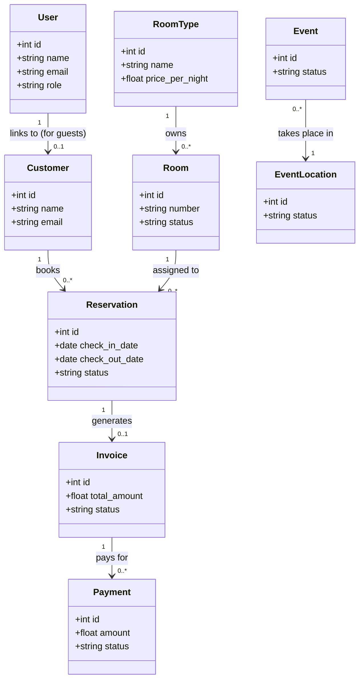

# 🏨 Hotel Management System (HMS) - Full Project Summary & Reference Guide

This document provides a comprehensive, technical overview of the Hotel Management System (HMS) codebase, database architecture, domain workflows, and security features.

---

## 1. System Architecture & Tech Stack

HMS is built using **Laravel 8** and runs on a local development setup (XAMPP with Apache and MariaDB/MySQL).

| Layer | Component | Details |
|---|---|---|
| **Core Framework** | Laravel 8 | PHP 8.2 compatible |
| **Database** | MariaDB / MySQL | Relational data with transactional consistency |
| **Frontend Rendering** | Blade Templates | Local CSS design system (dark theme) & Bootstrap 5 |
| **Interactivity** | Vanilla JS / AJAX / jQuery | Asynchronous room availability checks & real-time updates |
| **Asset Delivery** | 100% Localized | Offline-ready (air-gapped) — zero CDN dependencies |
| **Automated Testing** | PHPUnit | Feature and unit tests utilizing SQLite in-memory databases |

---

## 2. Core Modules & Domain Models

The database contains **17 key tables** which map to active Eloquent models in `app/Models/`:



### Key Models & Their Functions:
1. **User**: Credentials, active status, and RBAC roles (`admin`, `manager`, `staff`, `guest`).
2. **Customer**: Guest profiles (linked to `users` via email).
3. **RoomType & Room**: Individual room inventory and pricing tiers.
4. **Reservation**: Links a Customer to a Room for a specific check-in/check-out date range.
5. **Invoice & Payment**: Stores billing details, taxes, payment date, and transaction IDs.
6. **Event & EventLocation**: Manages venues (Rooftop, Conference rooms) and schedules hotel events.
7. **Staff**: Internal employee profiles linked to `users` for task/event assignment.
8. **ActivityLog**: Logs auditing details of all core operations.

---

## 3. Core Business Workflows & Automation

### 🛎️ A. Room Booking & Availability Check
- When creating a reservation, the frontend uses an **AJAX date-picker validation** endpoint (`ReservationController@availableRooms`).
- It flags overlapping date bookings by querying:
  `check_in_date < $requestedCheckOut` and `check_out_date > $requestedCheckIn`.
- Cancelled reservations are excluded from overlap checks.
- **Guest Capacity Validation**: Enforces strict, name-based occupancy limits per room type (Single Room = max 1 guest, Double Room = max 2 guests, Deluxe Family Room = max 4 guests) both in client-side HTML `max` attributes and server-side request rules.

### 💳 B. Invoice Generation & Tax Calculation
- **Auto-Invoice creation**: A Laravel Eloquent Observer (`ReservationObserver`) listens for the `confirmed` status on a reservation.
- It calculates subtotal (`nights * price_per_night`) and applies **customizable tax rates** fetched from the global `settings` table:
  - **Service Charge** (default 10%)
  - **SSCL** (default 2.5%)
  - **TDL** (default 1.0%)
  - **VAT** (default 18%)
- The observer saves these itemized charges on `Invoice::create` and automatically updates the invoice status to `sent`.

### 💵 C. Payment Processing & Auto-Settle
- **Strict Full-Payment Policy**: HMS enforces single-transaction payments. Partial payments are rejected by validation.
- **Auto-Invoice paid sync**: Recording a payment with status `completed` triggers an automatic update of the linked invoice status to `paid`.
- **Payment Method limitations**: The system supports **Cash, Card, and Bank Transfer**. Support for *Cheque* payments has been fully removed from both validation rules and UI options.

### 🔄 D. Check-In & Auto-Checkout Sync
- **Status Sync**: When a reservation status changes to `checked_in`, the associated room is updated to `occupied`. When it is changed to `checked_out`, the room changes back to `available`.
- **Auto-Checkout Middleware**: Registered globally in the `web` stack, the `AutoCheckOutMiddleware` runs on every request:
  - Finds all reservations whose status is `checked_in` and checkout date has passed.
  - If checkout is today, it verifies if the time is past the hotel's `check_out_time` (e.g. 12:00 PM).
  - If the invoice status is `paid`, it automatically changes the reservation status to `checked_out` and releases the room.

---

## 4. Security & Access Control (RBAC)

HMS utilizes custom route group middlewares (`RoleMiddleware`) in `routes/web.php` to restrict endpoints based on the authenticated user's role:

| Module / Action | Admin | Manager | Staff | Guest |
|---|---|---|---|---|
| **System Settings** | Read / Write | Denied | Denied | Denied |
| **Activity Logs** | Read Only | Denied | Denied | Denied |
| **Reports** | Read Only | Read Only | Denied | Denied |
| **Room/Food Config** | Read / Write | Read / Write | Denied | Denied |
| **Event Location Config** | Read / Write | Read / Write | Denied | Denied |
| **Reservations** | Read / Write | Read / Write | Read / Write | Read Only (Own) |
| **Invoices / Payments** | Read / Write (No Edit) | Read / Write (No Edit) | Read / Write (No Edit) | Read Only (Own) |

### 🔒 Deletion & Modification Safety Guards
To prevent accidental data loss and maintain accounting integrity:
- **No Resource Deletion**: Resource deletion is disabled system-wide. All delete endpoints/buttons have been removed from Blade views, and controller `destroy` methods return a `403` status.
- **No Invoice & Payment Modification**: Edit and update capabilities for invoices and payments are disabled system-wide. All edit endpoints/buttons have been removed from Blade views, routes are unregistered, and controller actions return a `403` status.

---

## 5. Audit Logging & System Activity Logs

To maintain a permanent audit trail:
- Core models use the custom `LogsActivity` trait.
- It hooks into Eloquent's model event listeners (`created`, `updated`, `deleted`).
- When a model is updated, the trait compares `$model->getOriginal()` with the current state and writes a record to the `activity_logs` table (including which fields changed, User IP, and browser metadata).
- Authentication events (Login, Logout, Failed attempts) are logged using Laravel's core auth event listeners registered in `EventServiceProvider`.
- Access to the log panel is strictly limited to the **Admin** role.
- **Excel Logs Export**: Administrators can export the filtered set of activity logs directly to Excel (.xlsx) spreadsheets using Maatwebsite Excel.

---

## 6. Viva Live Coding Cheat Sheet

### Essential Testing Commands
```bash
# Run all permission/feature tests (SQLite in-memory)
php artisan test

# Run a specific test class
php artisan test --filter=RoleAccessTest
php artisan test --filter=ReservationStatusSyncTest
php artisan test --filter=ReservationGuestValidationTest
```

### Essential Tinker Database Queries
```php
// Check active sessions in DB:
DB::table('sessions')->get();

// Find current reservation status:
App\Models\Reservation::find(19)->status;

// Find database connection state:
DB::connection()->getPdo();
```
