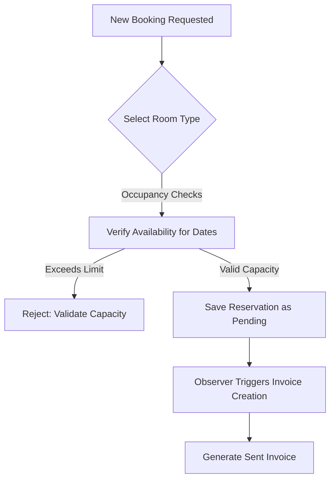

# 🏨 Hotel Management System (HMS) - User Manual (A to Z)

Welcome to the **Hotel Management System (HMS)** User Manual. This document provides a complete guide to the system's architecture, operations, user roles, billing workflows, and troubleshooting procedures.

---

## 📂 Table of Contents
1. [Introduction & Architecture](#-1-introduction--architecture)
2. [User Roles & Access Control (RBAC)](#-2-user-roles--access-control-rbac)
3. [Front Office & Reservations](#-3-front-office--reservations)
4. [Room & Inventory Operations](#-4-room--inventory-operations)
5. [Services & Event Management](#-5-services--event-management)
6. [Billing & Financials Workflow](#-6-billing--financials-workflow)
7. [System Administration & Auditing](#-7-system-administration--auditing)
8. [Guest Self-Service Portal](#-8-guest-self-service-portal)
9. [Troubleshooting & FAQ](#-9-troubleshooting--faq)

---

## 🏛️ 1. Introduction & Architecture

The HMS is an enterprise-grade web application built on the **Laravel 8** framework (PHP 7.3+), designed to manage hotel bookings, venues, food menus, invoicing, payments, and auditing.

### 🎨 Core Design System & Aesthetics
* **Premium Theme**: The portal features a custom dark-mode theme utilizing a **Deep Navy** background (`#111827`, `#1f2937`) paired with a **Gold / Champagne** secondary color (`#D4AF37`) for accents, links, hover highlighting, and call-to-actions.
* **Standardized Headers**: Administrative modules feature unified top-aligned header blocks containing search inputs and primary action buttons.
* **Scoped Module Stylesheets**: Per-module CSS files (e.g., `public/css/events.css`) keep the codebase clean by loading custom CSS declarations only where required.

### 🔌 Offline-Ready Strategy (Air-Gapped Friendly)
* **Zero CDN Policy**: To allow reliable deployments in remote, on-site, or offline hotel server environments, all third-party libraries are hosted locally under the `public/` directory.
* **Local Libraries**:
  * **CSS / Fonts**: Bootstrap 5, FontAwesome 6, Google Fonts (Inter, Outfit).
  * **JavaScript**: jQuery, Chart.js, FullCalendar 6, DataTables, SweetAlert2.

---

## 👥 2. User Roles & Access Control (RBAC)

The system restricts features based on four distinct user roles:

| Feature/Module | Guest | Staff | Manager | Admin |
| :--- | :---: | :---: | :---: | :---: |
| **Self-Service Booking** | View / Book | View / Pay | View / Pay | View / Pay |
| **Record/Process Payments** | No | Yes | Yes | Yes |
| **View Own Logs / Profile** | Yes | Yes | Yes | Yes |
| **Create Reservations / Guests** | No | Yes | Yes | Yes |
| **Modify Reservations / Guests** | No | No | Yes | Yes |
| **Setup Rooms / Room Types** | No | No | Yes | Yes |
| **Setup Food / Event Locations** | No | No | Yes | Yes |
| **Manage Events & Staff Actions** | No | No | Yes | Yes |
| **Configure Settings & Taxes** | No | No | No | Yes |
| **View Audit Logs & Excel Export** | No | No | No | Yes |

### 🚫 Data Safety & Immutability Rules
> [!IMPORTANT]
> To prevent data manipulation, fraud, or loss of operational history, the system enforces the following safety controls:
> 1. **No Deletions (Safety Guard)**: Database deletion operations are disabled system-wide. Any calls to controller `destroy()` methods abort with a `403 Forbidden` response, and delete buttons are excluded from views.
> 2. **Financial Immutability**: Recorded Payments and generated Invoices are immutable. They cannot be edited or modified by any user role (edit/update routes are omitted and controllers return `403` on edit requests).

---

## 🛎️ 3. Front Office & Reservations

The booking engine coordinates room inventory, customer records, and tax settings in real-time.

### 📅 Booking Workflow & Guest Count Validations
1. **Capacity Caps**: The system restricts the guest count input according to the chosen room type:
   * **Single Room**: Capped at **1** guest.
   * **Double Room**: Capped at **2** guests.
   * **Deluxe Family Room**: Capped at **4** guests.
2. **Date Availability Checks**: The booking form uses AJAX calls to query the database and confirm whether a room is free for the selected date range.
3. **Guest Identity Logs**: Staff must collect a National Identity Card (NIC) or Passport number (`nic_passport`) when registering or saving guest profiles.
4. **Guest Profile Searches**: Customers can be retrieved instantly using the index page search bar by matching their Name, Email, Phone, or **NIC/Passport Number**.
5. **Real-time Staff Notifications**: When a new reservation is created, the `ReservationObserver` automatically dispatches database alerts to all users with `admin`, `manager`, or `staff` roles. The notification bell in the navbar updates its red unread badge count instantly, letting staff know about guest self-service bookings immediately.

---

## 🛏️ 4. Room & Inventory Operations

The physical status of rooms and room setups are synchronized dynamically based on operational events.

### 🔄 Room Status Auto-Sync
* **Check-In Event**: When a guest check-in is logged (Reservation status becomes `checked_in`), the room status automatically transitions to **`occupied`**.
* **Check-Out Event**: When check-out is complete (Reservation status becomes `checked_out`), the room status automatically resets to **`available`**, making it clean and ready for the next guest.

### 🧼 Housekeeping & Cleanliness Flags
Rooms feature an `is_clean` boolean flag. If set to `false`, the room displays a warning on the front office console indicating it requires service before new check-ins can occur.

---

## 🍽️ 5. Services & Event Management

HMS includes custom modules to manage additional hospitality facilities.

### 🍕 Food Menu System
* **Menu Control**: Staff can manage menu listings, adjusting prices, names, and item descriptions.
* **Layout Design**: The menu listing table excludes the `Category` column for a cleaner visual layout, displaying Name, ID, Price (LKR), and Actions.

### 🎪 Events Scheduling & Venues
* **Event Bookings**: Customers can book specific hotel facilities (e.g., *Training Room*, *Conference Room*, *Rooftop Lounge*).
* **Venue Showcase**: Public users can view venue profiles, booking rates, and attendee capacities directly at the `/our-events` route.
* **Staff Assigning**: Managers can link employees to scheduled events with specified roles (e.g. *Lead Coordinator*, *Catering Supervisor*).

---

## 💳 6. Billing & Financials Workflow

The billing lifecycle is fully automated to prevent audit discrepancies.

### 🧾 Invoice Generation & Tax Breakdown
When a reservation is updated to **`confirmed`**, the `ReservationObserver` automatically generates an invoice. Taxes are calculated dynamically based on rates defined in the admin settings:
* **Service Charge**: Standard service charge (default `10%`).
* **SSCL (Social Security Contribution Levy)**: Calculated at `2.5%`.
* **TDL (Tourism Development Levy)**: Calculated at `1.0%`.
* **VAT (Value Added Tax)**: Standard value-added tax (default `18%`).

These are stored on the invoice as individual line items for customer transparency.

### 💰 Payments & Status Sync
1. **Full Settlement Rule**: The system does not support partial payments. The invoice must be paid in full in a single transaction.
2. **Immediate Record**: Setting a payment to `completed` automatically:
   * Updates the linked Invoice status to **`paid`**.
   * Updates the associated Reservation status to **`confirmed`**.
3. **Record Payment Restrictions**: If an invoice is already fully paid or has been cancelled (including refunded cases), the system hides the "Record Payment" button to prevent duplicate payments.

### 📥 PDF Invoices & Receipt Downloads
On the Invoice detail page, users can click the download action button:
* **Paid Invoices**: Button displays **Download Receipt** and exports a PDF receipt documenting all transaction details.
* **Unpaid Invoices**: Button displays **Download Invoice** and exports a standard PDF billing invoice.
* **Payment History Audit**: The PDF receipt includes a **Status** column showing whether individual payments were `COMPLETED`, `FAILED`, or `REFUNDED`.

---

## ⚙️ 7. System Administration & Auditing

Administrators have access to core configuration pages and logging views.

### 🔧 Settings Panel
* **Tax Rates**: Adjust percentage parameters for Service Charge, SSCL, TDL, and VAT.
* **Operational Rules**: Configure the default check-out time (e.g., `12:00:00`).

### 🕵️ System Activity Logs
The audit dashboard ([app/Http/Controllers/ActivityLogController.php](file:///D:/xampp/htdocs/HMS/app/Http/Controllers/ActivityLogController.php)) lists all system events:
* **Search / Filter**: Filter logs by User, Action Type (Create, Update, Delete, Login, Logout), or specific date ranges.
* **Metadata Tracking**: Captures user IP address and browser User-Agent details.
* **Excel Archiving**: Admins can export search results directly to an Excel sheet (`.xlsx`) with a single click.

### 📊 Reports & Analytics Dashboards
Managers and Admins have access to operational and financial intelligence reports:
* **Food & Beverage (F&B) Sales Report**: Aggregates food item orders from invoice lines. Displays names, unit prices, quantities sold, and total sales, calculating total revenue at the bottom.
* **Tax & Financial Levies Audit**: Breaks down invoice financials by subtotal, service charge, SSCL, TDL, VAT, and grand totals, presenting aggregate column sums in the table footer.
* **PDF & Excel Exports**: Supports local spreadsheet downloads (`.xlsx`) and print-friendly PDF generation for offline archiving.

### 🔒 Session Timeout Safeguards
An inactive user session triggers a modal warning popup after **13 minutes of inactivity**, warning that they will be automatically logged out due to inactivity at the **14-minute mark**.

---

## 🌐 8. Guest Self-Service Portal

Guests can self-register and manage bookings securely.

### 📝 Self-Registration & Customer Mapping
* During registration, the guest must provide a contact phone number and their NIC/Passport number.
* Registering automatically creates a corresponding profile inside the `customers` database table, matching the user by email.

### 🚫 Payment Actions Restriction
* Since online payment processing is disabled, the credit card pay icon is completely hidden from the guest's invoice list page.
* The "Record Payment" button on the invoice detail view is restricted and hidden from guest logins, preventing unauthorized entries.

---

## 🔧 9. Troubleshooting & FAQ

### ❌ Sort Error: SQL QueryException (`Column not found`)
* **Symptom**: Clicking a table sorting header triggers a database error page mentioning an unknown column.
* **Cause**: The whitelist array `$allowedSortColumns` in the controller contains a column name that doesn't match the database table schema (e.g. using `start_date` instead of `start_time` or `total` instead of `total_amount`).
* **Solution**: Check the whitelisted column parameters in the controller index method and ensure they map directly to database fields.

### ⏰ Auto-Checkout Middleware Configuration
* **Symptom**: Completed guest stays do not show as `checked_out`.
* **Cause**: Stays are only checked out automatically if:
  1. The checkout date has passed.
  2. The invoice is marked as **`paid`**.
  3. The reservation is in **`checked_in`** or **`confirmed`** status.
* **Solution**: Verify that the guest has settled their invoice. Once the invoice transitions to `paid`, the auto-checkout engine will update the reservation status on the next portal request.
